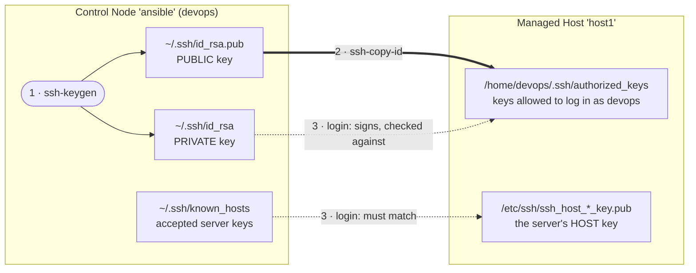
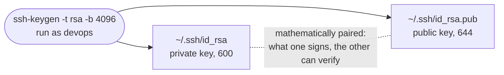
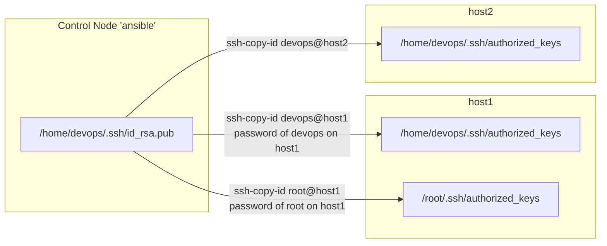
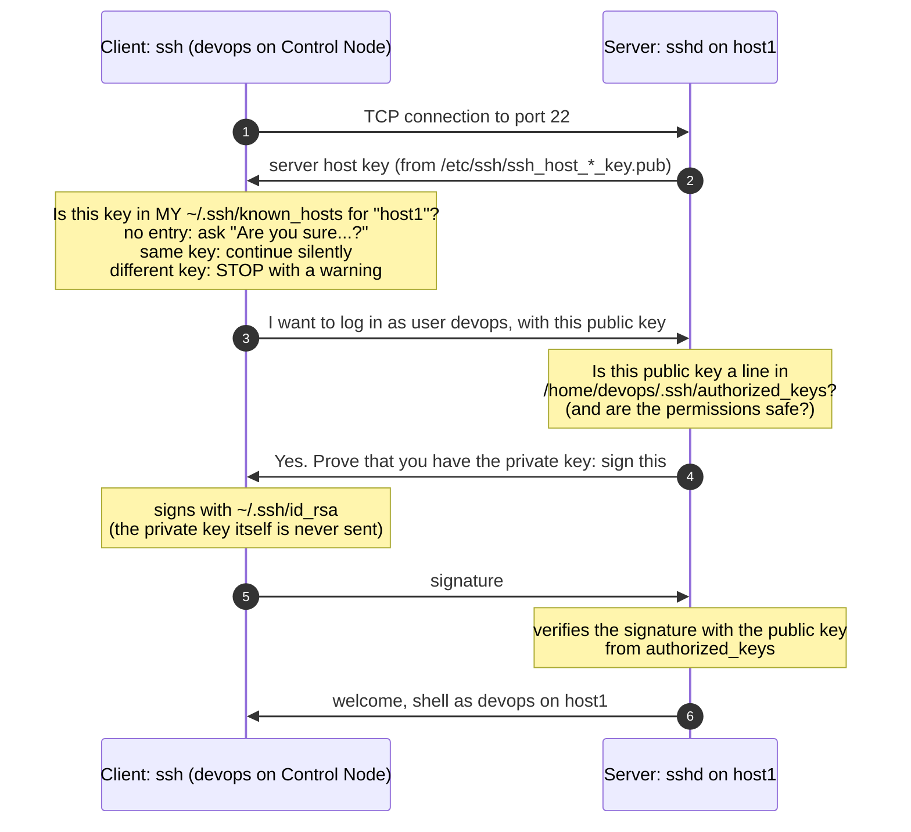
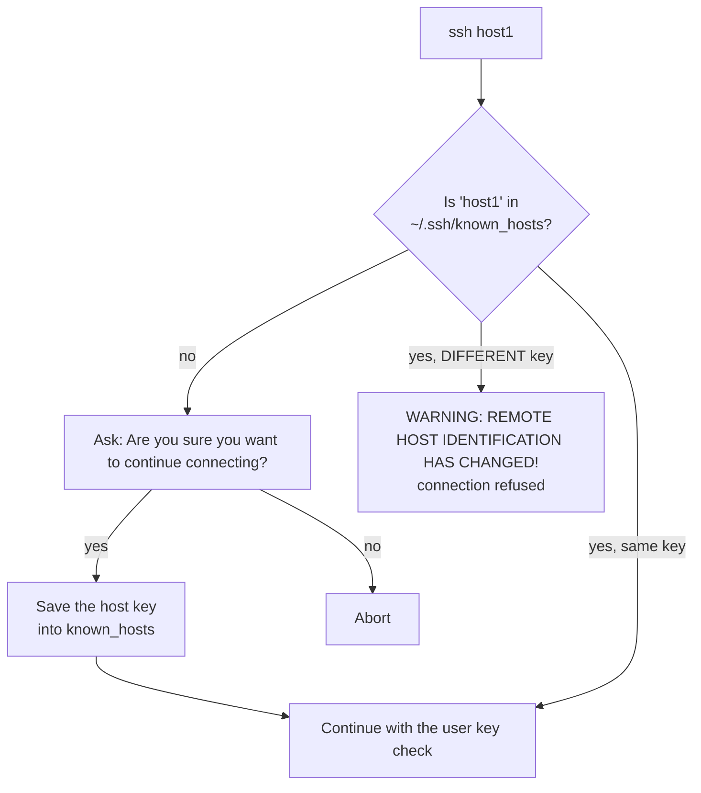
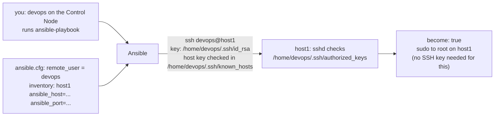

# SSH keys for Ansible: how passwordless login really works

You type `ssh host1` every day. This page explains what happens behind it, because Ansible needs it to work
**without any question or password**. If you understand the five files below and the three steps that create and
use them, you can set up and repair the SSH side of any Ansible environment on your own.

All examples use the training lab: user `devops` on the Control Node container `ansible` connects to the same user
`devops` on the Managed Hosts `host1`, `host2`, `host3` (this is exactly what `labenv/ansible_node/setup_ssh/setup_devops.sh`
sets up).

---
## The big picture



Two key pairs are involved, and they protect two different things:

| Key pair | Belongs to | Proves | Checked against |
|----------|-----------|--------|-----------------|
| `~/.ssh/id_rsa` + `id_rsa.pub` | **you** (the user on the client) | "I am allowed to log in as this account" | `~/.ssh/authorized_keys` **on the server**, in the home of the account you log in **as** |
| `/etc/ssh/ssh_host_*_key` + `.pub` | **the server** (created when sshd is installed) | "I am really host1, not an impostor" | `~/.ssh/known_hosts` **on the client**, in the home of the user who runs `ssh` |

The files:

| File | Where | Content | Permissions |
|------|-------|---------|-------------|
| `~/.ssh/` | both sides | directory of the user's SSH files | `700` (`drwx------`) |
| `~/.ssh/id_rsa` | client | your private key | `600` (`-rw-------`), **never copy it to another machine** |
| `~/.ssh/id_rsa.pub` | client | your public key, one line | `644` |
| `~/.ssh/authorized_keys` | server, in the **target account's** home | public keys allowed to log in as that account, one per line | `600`, owned by that account |
| `~/.ssh/known_hosts` | client | host keys of servers you have accepted, one per line | `644` |

---
## Step 1 · `ssh-keygen`: create your key pair

Run it **once**, as the user who will run Ansible (`devops` on the Control Node), not as root:

```bash
[devops@ansible ~]$ ssh-keygen -t rsa -b 4096
Generating public/private rsa key pair.
Enter file in which to save the key (/home/devops/.ssh/id_rsa):      <- Enter: keep the default name
Enter passphrase (empty for no passphrase):                         <- Enter: no passphrase (see below)
Enter same passphrase again:
Your identification has been saved in /home/devops/.ssh/id_rsa
Your public key has been saved in /home/devops/.ssh/id_rsa.pub

[devops@ansible ~]$ ls -l ~/.ssh
-rw-------. 1 devops devops 3381 Oct 26 10:00 id_rsa
-rw-r--r--. 1 devops devops  741 Oct 26 10:00 id_rsa.pub
```



The public key is a single line: key type, the key itself, and a comment (by default `user@host`, it is only a
label):

```
ssh-rsa AAAAB3NzaC1yc2EAAAADAQABAAACAQC7...lots of characters...Xw== devops@ansible
```

+ **The key belongs to the local user who created it.** `root` on the same machine has its own `/root/.ssh/` and
  does not use `devops`'s key. Running `sudo ssh-keygen` creates a key for root, not for you.
+ **Default names matter.** `ssh` and `ssh-copy-id` look for `~/.ssh/id_rsa`, `id_ecdsa`, `id_ed25519`
  automatically. A key with another name must be given with `-i` (or `private_key_file` in `ansible.cfg`).
+ **Passphrase:** it encrypts the private key file. Ansible cannot type it, so either leave it empty (lab) or load
  the key into an `ssh-agent` once per session (`eval $(ssh-agent)`, `ssh-add`), see
  [22_Navigator](../22_Navigator/README.md).
+ `ssh-keygen -t ed25519` creates a shorter, modern key (`id_ed25519`); it works the same way.
+ Running `ssh-keygen` again **overwrites** the old pair (it asks first). The old public key, already copied to the
  servers, then no longer matches anything you have.

---
## Step 2 · `ssh-copy-id`: put your public key into the other account

```bash
[devops@ansible ~]$ ssh-copy-id devops@host1
/usr/bin/ssh-copy-id: INFO: Source of key(s) to be installed: "/home/devops/.ssh/id_rsa.pub"
/usr/bin/ssh-copy-id: INFO: 1 key(s) remain to be installed -- if you are prompted now it is to install the new keys
devops@host1's password:                                            <- the password of devops ON host1
Number of key(s) added: 1

Now try logging into the machine, with:   "ssh 'devops@host1'"
```

What it does, step by step:

1. logs in to `host1` as `devops` **with a password** (one last time),
1. creates `/home/devops/.ssh/` on host1 if missing, with mode `700`,
1. **appends** the line of your `id_rsa.pub` to `/home/devops/.ssh/authorized_keys` on host1 (mode `600`),
1. does not touch your private key: it stays on the Control Node.



**The account after the `@` decides whose `authorized_keys` receives the key.** The local user decides **which**
public key is sent (the one in *your* `~/.ssh/`):

| You run, as | Command | Key sent | Written into |
|-------------|---------|----------|--------------|
| devops | `ssh-copy-id host1` | `/home/devops/.ssh/id_rsa.pub` | `/home/devops/.ssh/authorized_keys` on host1 (same user name by default) |
| devops | `ssh-copy-id root@host1` | `/home/devops/.ssh/id_rsa.pub` | `/root/.ssh/authorized_keys` on host1: devops may now log in **as root** |
| root (`sudo`) | `sudo ssh-copy-id devops@host1` | `/root/.ssh/id_rsa.pub` | `/home/devops/.ssh/authorized_keys` on host1: only **root** of the Control Node can now log in, not devops! |
| devops | `ssh-copy-id -p 2021 devops@127.0.0.1` | `/home/devops/.ssh/id_rsa.pub` | host1 through the port published on the lab VM ([22_Navigator](../22_Navigator/README.md)) |

`ssh-copy-id` needs password login on the server (`PasswordAuthentication yes` in `sshd_config`) and the account's
password. If that is not allowed (typical in a company), someone who can already log in adds the line by hand:

```bash
# on host1, as devops (or as root for another user, then fix the owner with chown)
mkdir -p ~/.ssh && chmod 700 ~/.ssh
echo 'ssh-rsa AAAAB3...Xw== devops@ansible' >> ~/.ssh/authorized_keys
chmod 600 ~/.ssh/authorized_keys
```

Later, Ansible itself can distribute keys to many users and hosts: `ansible.posix.authorized_key`
([14_LinuxAdminLabs/06-users](../14_LinuxAdminLabs/06-users/README.md)).

---
## Step 3 · `ssh host1`: what is checked at login



Two independent checks happen, in opposite directions:

| Check | Done by | Question | File |
|-------|---------|----------|------|
| **Host key** check | the **client** | "Is this really host1?" (protects you from talking to an impostor) | `~/.ssh/known_hosts` of the user running `ssh` |
| **User key** check | the **server** | "May this key log in as devops?" | `~/.ssh/authorized_keys` of the **target** account on the server |

If the user key check fails, sshd falls back to the next method, usually the password: **a password prompt means
your key was not accepted.**

---
## known_hosts: the client checks the server

The first time you connect to a server, its host key is unknown:

```
[devops@ansible ~]$ ssh host1
The authenticity of host 'host1 (10.89.0.3)' can't be established.
ED25519 key fingerprint is SHA256:mN4c0x2x8C4kPZQe0u0b7c3QwR8w6fJk1sYpVq2Kx9A.
Are you sure you want to continue connecting (yes/no/[fingerprint])? yes
Warning: Permanently added 'host1' (ED25519) to the list of known hosts.
```

`yes` appends a line to `~/.ssh/known_hosts`: the server's name (or IP, or `[127.0.0.1]:2021` for another port) and
its host key. From then on the check is silent.



**REMOTE HOST IDENTIFICATION HAS CHANGED** means the server answered with a different host key than last time.
In the lab this is normal after the containers were rebuilt (`run.sh`): the new containers generated new host keys.
Remove the old entry and connect again:

```bash
ssh-keygen -R host1                 # for a name
ssh-keygen -R "[127.0.0.1]:2021"    # for a host on another port
```

On a production server the same warning is a serious signal: find out **why** the key changed before you remove the
line.

> [!NOTE]
> **In the lab containers you will not see the question.** The Control Node image has `StrictHostKeyChecking no` in
> `/etc/ssh/ssh_config` (see `labenv/build_image/ssh_config`): new host keys are saved automatically
> (`Warning: Permanently added ...`), and a changed host key only prints the warning, the key login still goes on.
> This keeps the lab simple, but it switches off the protection described above. On the lab VM itself (e.g. in
> [22_Navigator](../22_Navigator/README.md), `127.0.0.1:2021`) and on real servers the normal behaviour applies.

#### known_hosts and Ansible

Ansible runs `ssh` without a terminal, so nobody can answer the "Are you sure...?" question: with an unknown host the
task fails with `Host key verification failed` (not in the lab containers, see the note above). Options:

1. Connect once by hand to every host (`ssh host1 exit`) and answer `yes`, or collect the keys in advance:
   `ssh-keyscan host1 host2 host3 >> ~/.ssh/known_hosts`
1. Lab only: `host_key_checking = False` in `ansible.cfg` (the lab's Execution Environments use this, see
   [22_Navigator](../22_Navigator/README.md)). Do not do this in production.

---
## How Ansible uses all this

Ansible simply runs `ssh` for you, as the **local user who started `ansible-playbook`**, to the account given by the
inventory and `ansible.cfg`:



| Ansible setting | SSH equivalent |
|-----------------|----------------|
| `remote_user` (ansible.cfg), `ansible_user` (inventory) | the `devops@` part |
| `ansible_host`, `ansible_port` | the host name / IP and `-p` |
| `private_key_file` (ansible.cfg), `ansible_ssh_private_key_file` | `-i ~/.ssh/other_key` |
| `host_key_checking` | `StrictHostKeyChecking` |
| `-k` / `--ask-pass` | password login instead of a key (needs `sshpass`) |
| `become: true` | not SSH at all: `sudo` on the Managed Host **after** the login |

So the rule is: **whatever `ssh devops@host1 whoami` does without a question, Ansible can do too.** Always test with
plain `ssh` first, as the same local user that will run Ansible:

```bash
ssh devops@host1 whoami     # expected: devops, with no password and no question
ansible host1 -m ansible.builtin.ping
```

---
## Setting up a working environment: checklist

On the Control Node, as the user who will run Ansible (`devops`):

```bash
whoami                                  # 1. the right local user? (not root)
ls -l ~/.ssh/id_*                       # 2. is there a key pair?
ssh-keygen -t rsa -b 4096               #    if not: create it (Enter, Enter, Enter)
for h in host1 host2 host3; do          # 3. copy the public key to every Managed Host
  ssh-copy-id devops@$h                 #    (asks the password of devops on each host once)
done
for h in host1 host2 host3; do          # 4. test: no password, no question
  ssh devops@$h hostname
done
ansible all -m ansible.builtin.ping     # 5. now Ansible works as well
```

---
## Troubleshooting

Add `-v` to see what ssh tries (`ssh -v devops@host1`, or `ansible ... -vvv`). The important lines:

```
debug1: Offering public key: /home/devops/.ssh/id_rsa RSA SHA256:...    <- the client offers this key
debug1: Server accepts key: /home/devops/.ssh/id_rsa RSA SHA256:...     <- found in authorized_keys
debug1: Authentications that can continue: publickey,password            <- key NOT accepted, falls back
```

| Symptom | Cause | Fix |
|---------|-------|-----|
| Password prompt instead of a login | The offered key is not in the target account's `authorized_keys` | `ssh-copy-id` to the **right account** (`user@host`), as the **right local user** |
| Password prompt, the key is in `authorized_keys` | Permissions too open on the server: sshd ignores the file (`StrictModes`). Home directory, `~/.ssh` or `authorized_keys` writable by others | `chmod 700 ~/.ssh; chmod 600 ~/.ssh/authorized_keys; chmod go-w ~` and the owner must be the user. The reason is in the server log: `sudo journalctl -u sshd` (on RHEL with rsyslog also `/var/log/secure`) |
| `WARNING: UNPROTECTED PRIVATE KEY FILE!` | Your private key is readable by others | `chmod 600 ~/.ssh/id_rsa` |
| `Permission denied (publickey)` | The server allows only keys, and yours is not accepted | as the first two rows; for `git@github.com` the key must be added to your GitHub account |
| Works with `ssh`, fails with `sudo ansible-playbook` | `sudo` makes root the local user: root's `~/.ssh` has no key and no known_hosts | Run Ansible as your normal user; use `become: true` for root rights on the hosts |
| `Host key verification failed` (Ansible) | The host is not in `known_hosts`, Ansible cannot answer the question (outside the lab containers) | `ssh host1 exit` once, or `ssh-keyscan` |
| `REMOTE HOST IDENTIFICATION HAS CHANGED` | The server has a new host key (lab containers rebuilt) | `ssh-keygen -R host1` |
| `Enter passphrase for key` on every task | The private key has a passphrase | `eval $(ssh-agent); ssh-add` once per terminal |
| `Connection refused` / `No route to host` | Not an SSH key problem: sshd not running, wrong port, firewall | `systemctl status sshd`, check `ansible_port` |

See also the step by step installation troubleshooting table in [02_TroubleshootConfig](../02_TroubleshootConfig/README.md).

---
## Exercise

1. On the Control Node, as devops: `cat ~/.ssh/id_rsa.pub`. Log in to host1 and find the same line in
   `~/.ssh/authorized_keys`. Which account's home is it in?
1. Run `ssh -v host1 exit 2>&1 | grep -E "Offering|accepts"`. Which key file is used?
1. On host1 make the key file unsafe: `chmod 666 ~/.ssh/authorized_keys`. Try `ssh host1` from the Control Node.
   What happens, and what does `sudo journalctl -u sshd | tail` say on host1? Restore with `chmod 600`.
1. Remove host2 from your known_hosts (`ssh-keygen -R host2`), then `ssh host2 exit`. Why are you not asked
   "Are you sure...?" (hint: `grep -i strict /etc/ssh/ssh_config`)? What would Ansible do with an unknown host on a
   machine without this setting?
1. Run `sudo ansible host1 -m ping`. Why does it fail although `ansible host1 -m ping` works? (In the default lab
   only devops has a key: `sudo ls /root/.ssh`.)
