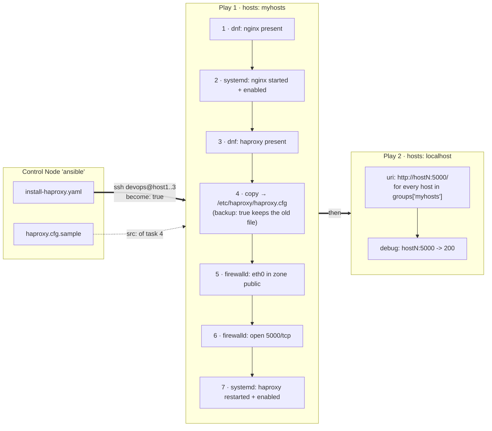
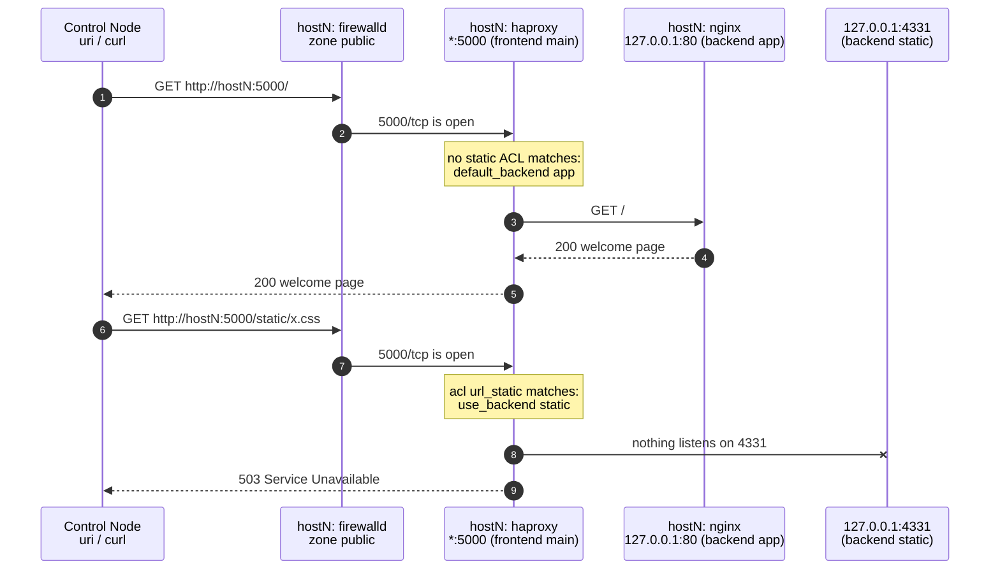

# HAProxy

### In this lesson the following subjects are covered

1. Install packages with `dnf`
1. Deploy a configuration file with `copy` (and keep a backup)
1. Open firewall ports with `ansible.posix.firewalld`
1. Start and enable services with `systemd`
1. Test the result from the Control Node with `uri` in a second Play

#### Figure 1. What the Playbook does



---
## The setup

On every Managed Host, HAProxy listens on port **5000** and forwards each request to the local nginx on port **80**.
Figure 2 shows the two kinds of requests of the test: the normal page, and a "static" URL that ends in a `503`.

#### Figure 2. A request through HAProxy



The relevant part of `haproxy.cfg.sample` (the default Fedora config, with the port changed to 5000):

```
frontend main
    bind *:5000
    ...
    default_backend             app

backend app
    balance     roundrobin
    server  app1 127.0.0.1:80 check
```

The sample also contains the distribution's `static` backend (`127.0.0.1:4331`), which does not exist in the lab.
Requests for `/static`, `/images`, `*.css`, `*.js` ... would therefore get a `503` error. Try it at the end!

---
## The Playbook

#### install-haproxy.yaml
```yaml
---
- name: Install and configure HAProxy in front of nginx
  hosts: myhosts
  become: true
  gather_facts: false

  tasks:
    - name: Ensure nginx (the backend webserver) is installed
      ansible.builtin.dnf:
        name: nginx
        state: present

    - name: Ensure nginx is started and enabled
      ansible.builtin.systemd:
        name: nginx
        state: started
        enabled: true

    - name: Ensure haproxy package is installed
      ansible.builtin.dnf:
        name: haproxy
        state: present

    - name: Copy haproxy configuration to node
      ansible.builtin.copy:
        src: haproxy.cfg.sample
        dest: /etc/haproxy/haproxy.cfg
        mode: "0644"
        owner: root
        group: root
        backup: true

    - name: Bind eth0 to public zone
      ansible.posix.firewalld:
        zone: public
        interface: eth0
        permanent: true
        immediate: true
        state: enabled

    - name: Open firewall port 5000 for haproxy
      ansible.posix.firewalld:
        port: 5000/tcp
        permanent: true
        immediate: true
        state: enabled

    - name: Enable and (re)start haproxy service
      ansible.builtin.systemd:
        name: haproxy
        state: restarted
        enabled: true

- name: Test the proxies from the Control Node
  hosts: localhost
  become: false
  gather_facts: false

  tasks:
    - name: Request the page through haproxy (port 5000)
      ansible.builtin.uri:
        url: "http://{{ item }}:5000/"
        return_content: true
      loop: "{{ groups['myhosts'] }}"
      register: result_proxy

    - name: Show the status codes
      ansible.builtin.debug:
        msg: "{{ item.item }}:5000 -> {{ item.status }}"
      loop: "{{ result_proxy.results }}"
      loop_control:
        label: "{{ item.item }}"
```

### Notes

- `ansible.builtin.copy` with `src:` looks for `haproxy.cfg.sample` next to the Playbook on the Control Node.
  `backup: true` keeps a timestamped copy of the previous `/etc/haproxy/haproxy.cfg` on the Managed Host.
- `ansible.posix.firewalld` comes from the `ansible.posix` collection (installed together with the `ansible` package).
  `permanent: true` writes the rule into the firewall configuration, `immediate: true` also applies it right now,
  so no separate `firewall-cmd --reload` is needed.
- `state: restarted` restarts HAProxy on **every** run, so this task is never `ok`, always `changed`.
  This guarantees that a new config file is picked up, but also restarts the service when nothing changed.
  In [12_ControlFlow](../../12_ControlFlow/README.md) you will learn about **handlers**, which restart a service
  only when its config file actually changed.

---
## Running the Playbook

```bash
ansible-playbook install-haproxy.yaml
```

Run it a second time: which tasks report `changed` and why?

### Testing by hand

```bash
curl -s http://host1:5000/ | head -5
curl -s -o /dev/null -w "%{http_code}\n" http://host1:5000/static/x.css    # 503, see above
```
