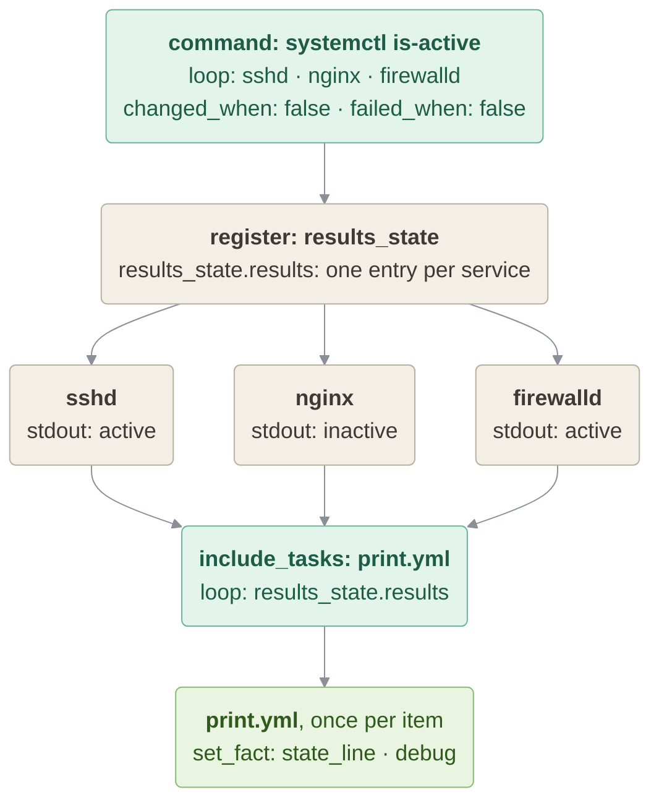

# Services, States

### In this lesson the following subjects are covered

1. Check the state of multiple services in a loop
1. Override task status with `changed_when` and `failed_when`
1. Reuse task logic across a loop with `include_tasks`
1. Register and format looped command results
1. Alternative: loop over nested Ansible facts



---
## Check the state of multiple services

`ansible.builtin.command` is looped over a list of service names, running `systemctl is-active` once per service and collecting all results into `results_state` (a pipe or redirection is not needed, so `command` is enough, no `shell`).

`systemctl is-active` returns a non-zero exit code for any service that is not active (e.g. `nginx` on a host where it was never installed). By default Ansible treats a non-zero exit code as a failure and would stop the Play for that host. Two task keywords fix the reported status:

- `failed_when: false` — this check never counts as failed, whatever the exit code
- `changed_when: false` — a read-only command never changes anything, so don't report `changed`

This is cleaner than `ignore_errors: true`, which prints a red error for every inactive service before ignoring it.

Note that `ansible.cfg` in this project turns on `become: true` by default, but checking a service state is a read-only operation, so this Play explicitly overrides it with `become: false`.

#### states.yml
```yaml
---
- name: Check Multiple Services State with include_tasks
  hosts: all
  become: false
  gather_facts: false

  tasks:

    - name: Check services is-active
      ansible.builtin.command: systemctl is-active {{ item }}
      register: results_state
      loop:
        - sshd
        - nginx
        - firewalld
      changed_when: false
      failed_when: false

    - name: Format and print result
      ansible.builtin.include_tasks: print.yml
      loop: "{{ results_state.results }}"
```

---
## Reuse task logic with include_tasks

When you `loop` over `include_tasks`, the included file is executed once per loop item, with `item` available inside it exactly as in an inline task. Here `results_state.results` is the list of per-item results produced by the looped `command` task above, so inside `print.yml` `item` refers to one such result, not to a service name.

`item.item` gives you back the original loop value (the service name), while `item.stdout` gives you the command's output (the state, e.g. `active` or `inactive`).

#### print.yml
```yaml
---
- name: Format the state line
  ansible.builtin.set_fact:
    state_line: "{{ item.item }} state: {{ item.stdout }}"

- name: Print the state line
  ansible.builtin.debug:
    var: state_line
```

> [!NOTE]
> `loop` is the current syntax. You will also meet the older `with_items:` in existing playbooks; for a simple list it does the same.

---
## Running the Playbook

```bash
ansible-playbook states.yml
```

Since `ansible.cfg` already points `inventory` at `./host_inventory`, there's no need to pass `-i` on the command line.

**Try this:** add `no_log: true` to the `command` task and run again. What disappears from the output? In real playbooks `no_log` is used for tasks that handle passwords or tokens.

---
## Alternative: loop over nested Ansible facts

The `alternative` subdirectory applies the same `include_tasks` + `loop` pattern to Ansible facts instead of command output. `ansible.builtin.setup` gathers facts first, and the loop items — `os_family` and `default_ipv4.address` — are inserted directly into the fact name inside `print.yml` using Jinja2.

#### alternative/setup.yml
```yaml
---
- name: Gather facts
  hosts: all

  tasks:

    - name: Setup
      ansible.builtin.setup:

    - name: Print in looped include_tasks
      ansible.builtin.include_tasks: print.yml
      loop:
        - "os_family"
        - "default_ipv4.address"
```

#### alternative/print.yml
```yaml
---
- name: Print one fact
  ansible.builtin.debug:
    var: ansible_facts.{{ item }}
```

---
## Running the Alternative Playbook

```bash
cd alternative
ansible-playbook -i myhosts setup.yml
```

Next: [03-sshd](../03-sshd/README.md) inspects a service with the `systemd` module instead of `systemctl`.
