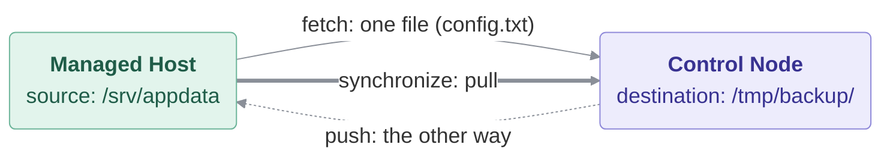

# Backup

### In this lesson the following subjects are covered

1. Prepare test data with `file` and a looped `copy`
1. Pull a single file back to the Control Node with `fetch`
1. Run a task once on the Control Node with `delegate_to` + `run_once`
1. Sync whole directory trees with `ansible.posix.synchronize` (rsync)
1. Understand `pull` vs `push` mode in `synchronize`



---
## Prepare some data to back up

`prepare.yml` creates `/srv/appdata` with three small files on every Managed Host, so this lab does not
depend on what earlier lessons left behind.

#### prepare.yml
```yaml
---
- name: Create some application data to back up
  hosts: myhosts
  become: true
  gather_facts: false
  vars:
    source_path: /srv/appdata

  tasks:

    - name: Create the data directory
      ansible.builtin.file:
        path: "{{ source_path }}"
        state: directory
        mode: '0755'

    - name: Create a few data files
      ansible.builtin.copy:
        dest: "{{ source_path }}/{{ item }}"
        content: "{{ item }} of {{ inventory_hostname }}\n"
        mode: '0644'
      loop:
        - config.txt
        - data1.txt
        - data2.txt
```

```bash
ansible-playbook prepare.yml
```

---
## Pull a single file back to the Control Node

`ansible.builtin.fetch` works the opposite way to `copy`: it copies a file **from** the Managed Host **to** the
Control Node, automatically nesting it under a per-host subfolder of `dest` (`dest/<host>/<full path>`) so
files from different hosts never collide. It's built for grabbing a handful of specific files — logs, configs,
a single backup file — not whole directory trees.

## Prepare a destination directory on the Control Node

`ansible.builtin.file` with `state: directory` creates `dest_path` if it doesn't already exist.
`delegate_to: localhost` is what makes this run on the Control Node instead of the current Managed Host,
`run_once: true` makes it run only once instead of once per Managed Host, and `become: false` creates the
directory as `devops`, not as root.

`ansible_play_hosts_all` is a magic variable holding every host taking part in the Play.

#### fetch.yml
```yaml
---
- name: Backup with fetch
  hosts: myhosts
  become: true
  gather_facts: false
  vars:
    source_path: /srv/appdata
    dest_path: /tmp/backup/fetch

  tasks:

    - name: Print all hosts of the Play
      ansible.builtin.debug:
        var: ansible_play_hosts_all
      run_once: true

    - name: Create the backup dir on the Control Node
      ansible.builtin.file:
        path: "{{ dest_path }}"
        state: directory
        mode: '0755'
      delegate_to: localhost
      run_once: true
      become: false

    - name: Backup one file with fetch
      ansible.builtin.fetch:
        src: "{{ source_path }}/config.txt"
        dest: "{{ dest_path }}"
```

```bash
ansible-playbook fetch.yml
tree /tmp/backup/fetch
```

---
## Sync whole directory trees with rsync

`ansible.posix.synchronize` wraps the `rsync` command line tool, making it available as an Ansible task.
Unlike `fetch`, it's built for entire directory trees, and only transfers files that actually changed since the
last run, making repeated backups fast. It needs `rsync` on **both** ends — hence the two `dnf` tasks.

## Understand pull vs push mode in synchronize

`mode: pull` makes `synchronize` run the transfer as if issued from the Control Node, reaching out and pulling
files *from* the Managed Host — the natural direction for a backup. `mode: push` (the default) does the opposite:
it sends files *from* the Control Node *to* the Managed Host, which is what you'd want when deploying files out
rather than backing them up.

#### rsync.yml
```yaml
---
- name: Backup with rsync
  hosts: myhosts
  become: true
  gather_facts: false
  vars:
    source_path: /srv/appdata
    dest_path: /tmp/backup/rsync

  tasks:

    - name: Install rsync on the Managed Hosts
      ansible.builtin.dnf:
        name: rsync
        state: present

    - name: Install rsync on the Control Node
      ansible.builtin.dnf:
        name: rsync
        state: present
      delegate_to: localhost
      run_once: true

    - name: Create the backup dir on the Control Node
      ansible.builtin.file:
        path: "{{ dest_path }}"
        state: directory
        mode: '0755'
      delegate_to: localhost
      run_once: true
      become: false

    - name: Backup the whole directory with rsync
      ansible.posix.synchronize:
        src: "{{ source_path }}"
        dest: "{{ dest_path }}/{{ inventory_hostname }}"
        mode: pull
      become: false
```

```bash
ansible-playbook rsync.yml
tree /tmp/backup/rsync
```

**Try this:** run `rsync.yml` again (nothing changes), then change one file on host2
(`ssh host2 "echo more | sudo tee -a /srv/appdata/data1.txt"`) and run it once more. Which host reports `changed`?
