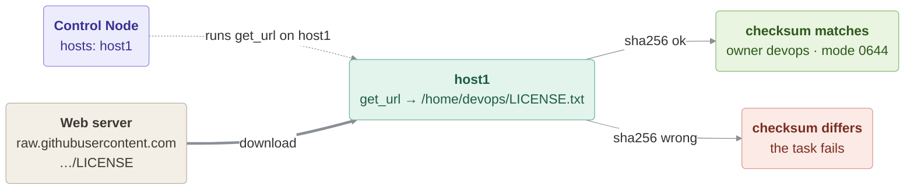

# Download

### In this lesson the following subjects are covered

1. Target a single host with `hosts`
1. Download a file with `get_url`
1. Verify integrity with a checksum
1. Set ownership and permissions on the downloaded file



---
## Target a single host with hosts

So far most Plays in this section have run against `hosts: all` or `myhosts`. Here `hosts: host1` restricts the
entire Play to just that one Managed Host — useful whenever a task only needs to happen on a single machine rather
than the whole inventory group.

---
## Download a file with get_url

`ansible.builtin.get_url` downloads a file from `url` straight onto the **Managed Host** at `dest` (the Managed Host
needs network access to the URL, not the Control Node), acting like `curl` or `wget` wrapped as an idempotent
Ansible task: if `dest` is a file that already exists and matches the checksum, it isn't downloaded again.

---
## Verify integrity with a checksum

`checksum` lets `get_url` confirm the downloaded file is exactly what was expected before keeping it, failing the
task if it doesn't match. The format is `<algorithm>:<value>`, e.g. `sha256:b290...`. The value can also be a URL
of a checksum file (`sha256:https://example.com/file.tar.gz.sha256`), which `get_url` fetches first.

Compute a checksum yourself with `sha256sum <file>`.

#### download.yml
```yaml
---
- name: File download
  hosts: host1
  become: false
  gather_facts: false
  vars:
    # Any file reachable over http(s) works. Without internet access use a webserver inside the lab,
    # e.g. "http://host2/index.html" (and remove the checksum line below).
    myurl: "https://raw.githubusercontent.com/csurgay/ansible/main/LICENSE"
    mycrc: "sha256:b2902d0c1dac109b92bce9f374b01de0d0aed90bf500849d1c33110d8a93a231"
    mydest: "/home/devops/LICENSE.txt"

  tasks:

    - name: File Download
      ansible.builtin.get_url:
        url: "{{ myurl }}"
        dest: "{{ mydest }}"
        checksum: "{{ mycrc }}"
        owner: devops
        group: devops
        mode: '0644'
```

---
## Set ownership and permissions on the downloaded file

Just like `copy`, `get_url` accepts `owner`, `group` and `mode` to set the downloaded file's permissions in the
same task — no separate `file` task is needed afterwards.

---
## Running the Playbook

```bash
ansible-playbook download.yml
ssh host1 head -3 LICENSE.txt
```

**Try this:** change one character of the checksum and run again with a different `mydest`. What does Ansible
report?

> [!NOTE]
> The download needs internet access from host1 (through the corporate proxy, if any). Without it, set `myurl`
> to a page served inside the lab, e.g. `http://host2/index.html` after [01-webserver-testing](../01-webserver-testing/README.md),
> and remove the `checksum` line.
