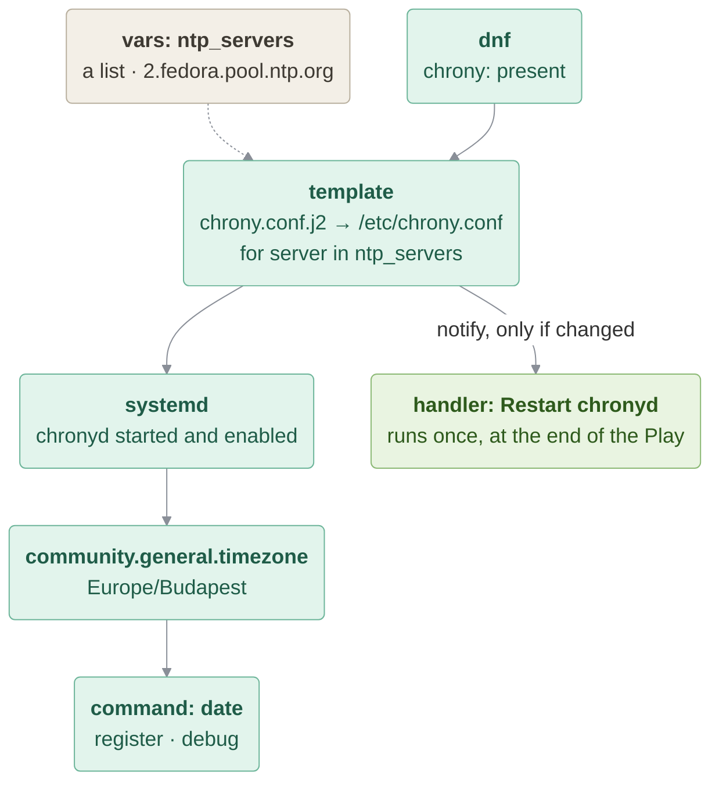

# Chrony

> [!WARNING]
> chronyd adjusts the **system clock**. Containers share the kernel, and so the clock, with the host: in the lab's
> privileged containers chronyd may change the clock of the builder VM itself, and three containers would compete
> for it. Run this lesson rootful (`sudo podman ...`, as the lab does) and preferably against VMs, never rootless
> (see `RUN_THIS_ROOTFUL_OR_ON_VM_NOT_ROOTLESS_CONTAINER`). In a rootless container chronyd cannot set the clock at all.

### In this lesson the following subjects are covered

1. Deploy a config file with `template`, using a list variable
1. Restart a service only when its config changed: `notify` + handler
1. Make sure a service is running and enabled
1. Set the system timezone with a collection module
1. Confirm the result with `command` and `debug`



---
## Deploy a config file with template

`ansible.builtin.template` renders `chrony.conf.j2` through Jinja2 on the Control Node and copies the result to the
Managed Host. The NTP servers come from the `ntp_servers` list variable, so the same template works in every
environment:

```
# {{ ansible_managed }}

pool {{ server }} iburst

...
```

`{{ ansible_managed }}` writes a "this file is managed by Ansible" comment into the file, a hint for anybody who
would edit it by hand. `backup: true` saves a timestamped copy of the previous `/etc/chrony.conf` before overwriting it.

> [!NOTE]
> Public NTP pools are usually blocked in corporate networks. Put your company's NTP servers into `ntp_servers`.

---
## Restart only when needed: handlers

A new `chrony.conf` is only picked up after chronyd is restarted. Restarting on **every** run (a task with
`state: restarted`) would work, but it is never idempotent and interrupts the service for nothing.
Instead, the template task `notify`-es the `Restart chronyd` handler: handlers run at the end of the Play, and only
if a notifying task reported `changed`. The separate `state: started` + `enabled: true` task makes sure the service
runs even when the config did not change. (Handlers are covered in detail in [12_ControlFlow](../../12_ControlFlow/README.md).)

---
## Set the system timezone

`community.general.timezone` sets the Managed Host's timezone — note the `community.general` collection prefix,
since this one isn't part of `ansible.builtin`. The timezone only affects how local time is **displayed**;
chrony itself synchronizes the clock in UTC, independent of the timezone.

#### chrony.yml
```yaml
---
- name: Install, configure and run chrony (NTP)
  hosts: myhosts
  become: true
  gather_facts: false
  vars:
    # Use your company's NTP servers here, public pools are often blocked in corporate networks
    ntp_servers:
      - 2.fedora.pool.ntp.org

  tasks:

    - name: Make sure chrony is installed
      ansible.builtin.dnf:
        name: chrony
        state: present

    - name: Deploy chrony.conf from template
      ansible.builtin.template:
        src: chrony.conf.j2
        dest: /etc/chrony.conf
        owner: root
        group: root
        mode: '0644'
        backup: true
      notify: Restart chronyd

    - name: Make sure chronyd is started and enabled
      ansible.builtin.systemd:
        name: chronyd
        state: started
        enabled: true

    - name: Set timezone
      community.general.timezone:
        name: Europe/Budapest

    - name: Get date and time
      ansible.builtin.command:
        cmd: date
      register: result_date
      changed_when: false

    - name: Print date
      ansible.builtin.debug:
        var: result_date.stdout

  handlers:

    - name: Restart chronyd
      ansible.builtin.systemd:
        name: chronyd
        state: restarted
```

---
## Confirm the result with command and debug

The Playbook finishes by running `date` on the Managed Host and printing its output — a quick, visible way to confirm
the timezone change actually took effect. `changed_when: false` because reading the date changes nothing.

---
## Running the Playbook

```bash
ansible-playbook chrony.yml
ssh host1 chronyc sources
```

**Try this:** run the Playbook twice — the handler runs only the first time. Then add a second server to
`ntp_servers` and run again: the template changes and the handler fires.
