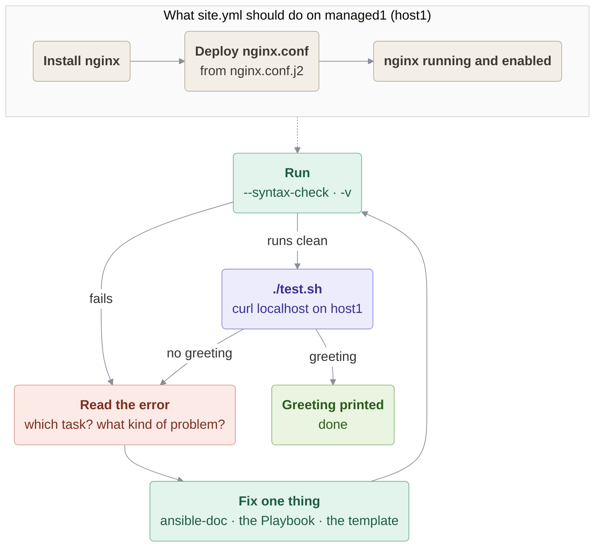

# Troubleshoot

### In this lesson the following subjects are covered

1. Reading Ansible's error output to find the failing task
1. Using `--syntax-check`, `-v` and `ansible-doc` to locate problems
1. Fixing one problem at a time until the acceptance test passes



---
## The scenario

`site.yml` is supposed to install `nginx`, deploy a config from a Jinja2 template, and make sure the service is running and enabled — ending with a web server that answers `curl localhost` with a friendly greeting. As given, it doesn't work. Your job is to run it, read what Ansible tells you, and fix it until `test.sh` succeeds.

Don't just guess and edit at random — treat every failure as a clue about *why* that specific task couldn't do what it was asked.

---
## Before you start

The lab hosts are shared by all lessons. Make sure no other webserver occupies port 80 on host1, otherwise nginx
cannot start even after all fixes (`managed1` is host1, see `inventory.ini`):

```bash
ansible managed1 -b -m systemd -a "name=httpd state=stopped"
ansible managed1 -b -m systemd -a "name=lighttpd state=stopped"
```

(These may report that the service does not exist — that's fine.)

> [!NOTE]
> `site.yml` replaces the **whole** `/etc/nginx/nginx.conf` of host1 with a minimal one. To restore the
> distribution's config after the lab:
> `ssh host1 sudo cp /etc/nginx/nginx.conf.default /etc/nginx/nginx.conf && ssh host1 sudo systemctl restart nginx`

---
## Files in this lesson

- **`site.yml`** — the Playbook to fix.
- **`nginx.conf.j2`** — the Jinja2 template it deploys.
- **`inventory.ini`** — a single Managed Host, `managed1`.
- **`ansible.cfg`** — minimal project config (it points `inventory` at `inventory.ini`).
- **`test.sh`** — the acceptance check: it should print the greeting from the template once the site is working.

---
## Reading Ansible's error output

Ansible names the failing task in its output, and the message just below it usually tells you the category of problem — a module that couldn't be found, a permission error, an undefined variable. Start with:

```bash
ansible-playbook --syntax-check site.yml
ansible-playbook -v site.yml
```

`--syntax-check` catches YAML structure problems before anything runs; `-v` (or `-vvv` for more detail) shows you the full error for whichever task fails first. Fix one error, re-run, and move on to the next — Ansible normally stops at the first failure per host, so later problems won't show up until earlier ones are resolved.

---
## Hints

Try without them first! Open one only when you are stuck.

<details>
<summary>Hint 1</summary>

**Validating module names with ansible-doc**


If a task fails claiming the module couldn't be resolved, don't assume the module doesn't exist — check the exact name and collection first:

```bash
ansible-doc ansible.builtin.service
```

A missing or misnamed module produces a very specific, very literal error message — read it carefully, it usually names exactly what Ansible tried and failed to find.

</details>

<details>
<summary>Hint 2</summary>

**Checking privilege escalation requirements**


Installing packages and writing into `/etc` are both root-level operations. If a task fails with something resembling "Permission denied", check whether the Play (or that specific task) has the privilege escalation it needs.

</details>

<details>
<summary>Hint 3</summary>

**Catching undefined Jinja2 variables in a template**


`ansible.builtin.template` renders every `{{ ... }}` expression in the source file before deploying it. If the template references a variable that was never defined anywhere in the Play, Ansible raises an `AnsibleUndefinedVariable` error and refuses to deploy. When you hit this, compare what the `.j2` file actually references against what's defined under `vars:`.

</details>

<details>
<summary>Hint 4</summary>

**Making sure a handler is notified by the right task**


A `handlers:` block only fires when a task explicitly `notify`s it, and only for tasks that actually report `changed`. It's entirely possible for a Play to run green, top to bottom, while a config change silently never reaches the running service — because the task that changed the file wasn't the one wired up to the handler. Check every task that touches something the handler is meant to react to, not just the first one.

</details>

---
## site.yml (as provided)

```yaml
---
- name: Configure web server
  hosts: webservers
  become: false

  vars:
    http_port: 80

  tasks:
    - name: Install nginx
      ansible.builtin.package:
        name: nginx
        state: present
      notify: Restart nginx

    - name: Deploy nginx config from template
      ansible.builtin.template:
        src: nginx.conf.j2
        dest: /etc/nginx/nginx.conf

    - name: Ensure nginx is running and enabled
      ansible.builtin.servics:
        name: nginx
        state: started
        enabled: true

  handlers:
    - name: Restart nginx
      ansible.builtin.service:
        name: nginx
        state: restarted
```

---
## Validating your fix

```bash
ansible-playbook site.yml
./test.sh
```

`test.sh` runs `curl -s localhost` on the Managed Host over SSH — success means it prints the greeting defined in `nginx.conf.j2`, naming the host that served it.
