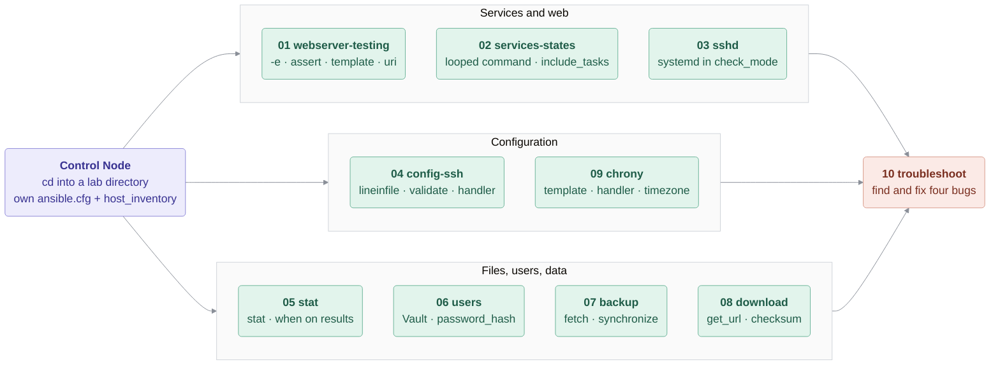

# Section 14. Linux Admin Labs

Real-life Playbooks for everyday Linux administration. They combine everything from the previous sections:
variables and `-e` ([08](../08_Variables/README.md)), facts ([10](../10_Facts/README.md)),
Vault ([11](../11_Vault/README.md)), loops, conditions, handlers and error handling ([12](../12_ControlFlow/README.md))
and templates ([13](../13_Templates/README.md)).

Each lab is a small Ansible project directory with its own `ansible.cfg` and `host_inventory`:
`cd` into it and run the Playbooks from there.

| Lab | Topics |
|-----|--------|
| [01-webserver-testing](01-webserver-testing/README.md) | `-e` variables, `assert`, `set_fact` + `when`, `template`, `uri` tests |
| [02-services-states](02-services-states/README.md) | Looped `command`, `changed_when` / `failed_when`, looped `include_tasks` |
| [03-sshd](03-sshd/README.md) | Inspect a service with `systemd` in `check_mode` |
| [04-config-ssh](04-config-ssh/README.md) | `vars_prompt`, `lineinfile` with `validate`, handlers, `copy` with `content` |
| [05-stat](05-stat/README.md) | `stat`, `when` on registered results, per-host conditions |
| [06-users](06-users/README.md) | Users from a list, Vault-encrypted passwords, `password_hash`, `authorized_key` |
| [07-backup](07-backup/README.md) | `fetch` vs `ansible.posix.synchronize`, `delegate_to` + `run_once` |
| [08-download](08-download/README.md) | `get_url` with checksum |
| [09-chrony](09-chrony/README.md) | Config from template, handlers, `community.general.timezone` |
| [10-troubleshoot](10-troubleshoot/README.md) | Find and fix four bugs in a broken Playbook |

> [!NOTE]
> The labs change the state of the shared Managed Hosts (`host1`..`host3`): webservers on port 80, the sshd
> configuration, users. Each lab README states what it expects (e.g. which webserver may run on port 80); most labs
> clean up their own preconditions. If the lab gets into a state you cannot repair, recreate the containers with `sudo ./run.sh` in `labenv` on the builder VM
> (this resets everything, see the main [README](../../README.md)).
